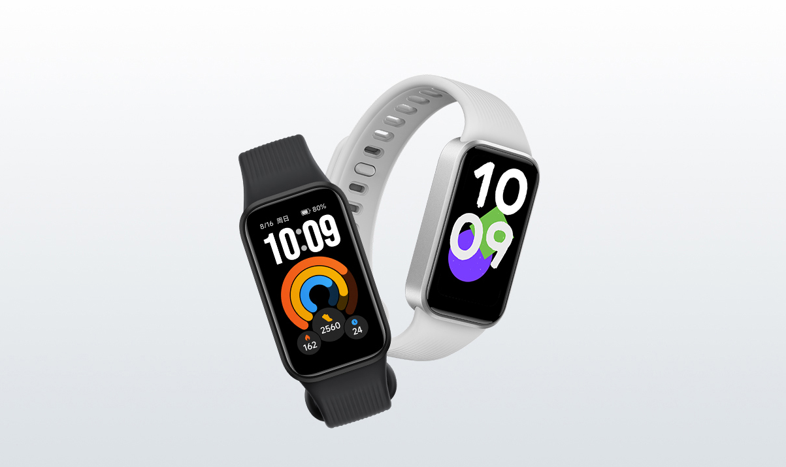

Pasar menos tiempo pendiente del cargador es el principal reclamo de la **REDMI Band 4**, pero conviene leer la cifra completa: los hasta 21 días de autonomía se quedan en hasta ocho con la monitorización habitual. La pulsera se ha estrenado en China este 20 de octubre por **169 yuanes**, según [MyDrivers](https://news.mydrivers.com/1/1158/1158901.htm) y [Gizmochina](https://www.gizmochina.com/2026/10/20/redmi-band-4-launches-with-a-21-day-battery-and-60hz-screen/), que coinciden en esos datos y en su pantalla de 60 Hz.

## REDMI Band 4: una pantalla de 1,47 pulgadas y 60 Hz

Ambos medios describen un panel de **1,47 pulgadas**, con cubierta de cristal 2.5D y una frecuencia de actualización de 60 Hz. MyDrivers añade una resolución de 172 × 320 píxeles. Sobre el papel, el refresco apunta a una navegación más fluida por la interfaz; no es una medición de respuesta realizada por este medio.

El diseño combina un marco de aspecto metálico con una correa de textura vertical y un cierre de pasador renovado. Ese acabado no basta para afirmar que toda la carcasa sea de metal. MyDrivers recoge, además, más de cien esferas y dos acabados, oscuro y plateado.

## Hasta 21 días de batería, pero ocho con monitorización habitual

La diferencia entre los dos escenarios de autonomía es el dato más útil para quien quiera llevarla también al dormir. MyDrivers sitúa la capacidad de la batería en **300 mAh** y recoge hasta ocho días en el modo de monitorización habitual, frente al máximo de 21 días. Gizmochina reproduce esas dos duraciones.

Por tanto, no conviene interpretar las tres semanas como una promesa de uso con todas las mediciones activadas. Las fuentes consultadas no detallan un protocolo completo que permita reproducir ambos resultados, y aquí no se ha probado la autonomía real. Para comparar pulseras, importa tanto la duración como qué funciones permanecen encendidas en cada escenario.

La distinción también sirve al revisar otras propuestas de la marca, como la [Xiaomi Smart Band 11 y sus diferentes modos de autonomía](/noticias/xiaomi-smart-band-11-watch-s5/): compartir una cifra máxima no convierte sus condiciones de uso en equivalentes.

## Cincuenta modos deportivos y resistencia de 5 ATM

La información publicada atribuye a la Band 4 **50 modos deportivos**, entre ellos carrera, ciclismo y tenis de mesa, y una resistencia al agua de **5 ATM**. Son características anunciadas, no resultados de una prueba de entrenamiento o de inmersión de TechSpain24.

En el seguimiento cotidiano, los dos medios enumeran registro del pulso, oxígeno en sangre, estrés y sueño, además de funciones de seguimiento de la salud femenina. La presencia de estas herramientas no acredita por sí sola su precisión clínica ni permite tratarlas como un diagnóstico.

Fuera del ejercicio, MyDrivers menciona control de música, recordatorios de calendario, consulta del tiempo y búsqueda del dispositivo. Ambos artículos también recogen pagos mediante códigos QR de WeChat y Alipay en China; ese dato no confirma compatibilidad con servicios de pago españoles.

## Precio en China y alcance de la confirmación

Los **169 yuanes** corresponden al lanzamiento chino descrito por la prensa. La [tienda oficial de Xiaomi en China](https://www.mi.com/shop/buy?product_id=25768) incluye una entrada para la REDMI Band 4 en su catálogo, pero la página accesible durante esta consulta no mostró una ficha completa con precio y especificaciones. Por eso, las cifras anteriores se atribuyen a MyDrivers y Gizmochina, no a una comprobación directa de la documentación técnica del fabricante.

Si se busca una pulsera sencilla para registrar actividad y consultar información en la muñeca, la propuesta merece seguimiento. Si la prioridad es comprarla en España o conocer cuánto dura con una configuración concreta, conviene esperar a información local y pruebas de uso: estas fuentes no permiten fijar una fecha española ni un precio en euros.
