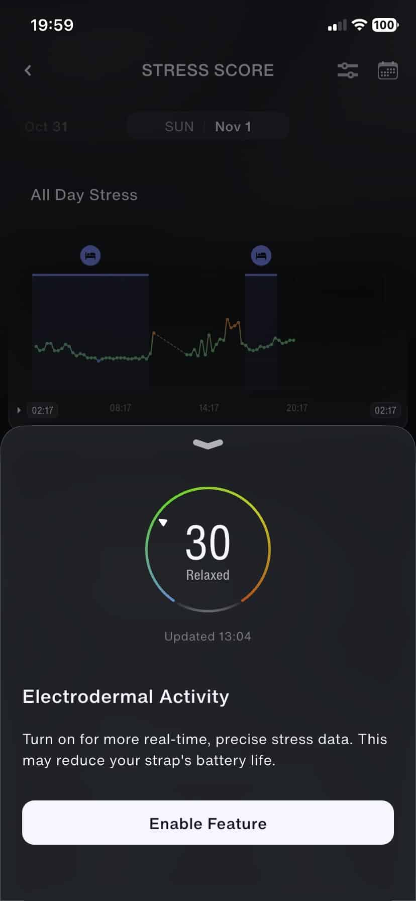
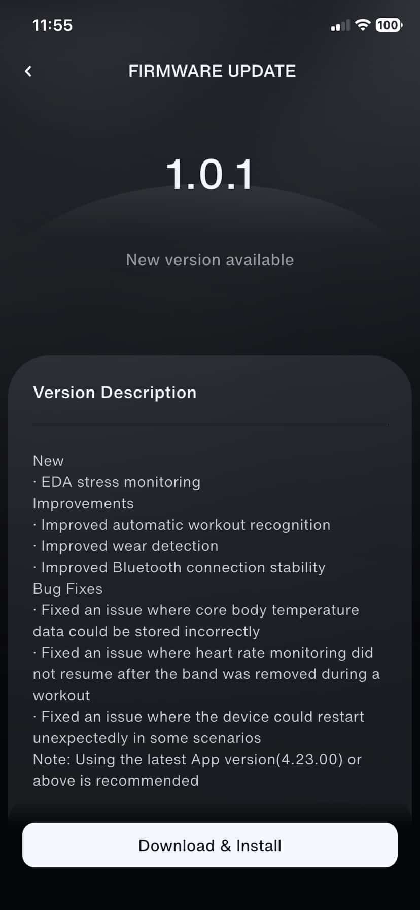

La **Speediance Strap Pro** empieza a aprovechar su sensor de actividad electrodérmica para el seguimiento del estrés. Según [Gadgets & Wearables](https://gadgetsandwearables.com/2026/11/01/speediance-strap-pro-gets-eda-stress-monitoring/), el firmware **1.0.1** incorpora esta función y mejora el reconocimiento automático de entrenamientos. Para quien ya utiliza la pulsera sin pantalla, la novedad es una señal adicional en la aplicación, no un diagnóstico de cómo se encuentra: las puntuaciones siguen siendo estimaciones que necesitan contexto.

El medio publicó la información el 1 de noviembre y la presenta como la primera actualización de firmware del dispositivo. Su cobertura incluye dos capturas de la aplicación: una con las notas de la versión y otra con la opción de activar la actividad electrodérmica. Son la referencia documental de los cambios, no resultados de una prueba realizada por TechSpain24.

## Qué aporta la EDA a la Speediance Strap Pro

EDA es la sigla de actividad electrodérmica. El sensor registra pequeñas variaciones en las propiedades eléctricas de la piel, relacionadas con la actividad de las glándulas sudoríparas. Gadgets & Wearables explica que esa señal puede reflejar indirectamente estrés fisiológico. Eso no equivale a leer emociones ni a identificar una enfermedad.

Hay un matiz importante para los usuarios actuales. Marko Maslakovic, autor de la noticia y del análisis previo del dispositivo, señala que la pulsera ya producía una puntuación de estrés minuto a minuto durante sus pruebas. Sin embargo, considera que entonces no parecía utilizar los datos del sensor EDA. La actualización no debe interpretarse, por tanto, como la llegada del primer indicador de estrés, sino como la incorporación anunciada de esta medición específica.

El mismo medio identifica el sensor EDA como una de las diferencias de hardware entre la Strap Pro y la versión sin apellido Pro. Esta noticia se refiere al modelo Pro; no confirma que la otra pulsera reciba una función equivalente.

*Captura publicada por Gadgets & Wearables. La aplicación advierte de que activar la función puede reducir la autonomía.*

La advertencia importa tanto como la nueva métrica: la pantalla ofrece habilitar EDA y avisa de un posible impacto en la batería. No proporciona una cifra de horas o días perdidos. Tampoco permite dar por demostrada una mejora concreta de precisión, aunque la interfaz promocione datos más precisos y en tiempo real.

## Firmware 1.0.1 y aplicación 4.23.00: los otros cambios

Las notas de versión visibles en la captura de Gadgets & Wearables enumeran mejoras en **reconocimiento automático de entrenamientos**, detección de que la pulsera está puesta y estabilidad de la conexión Bluetooth. Son ajustes menos llamativos que una métrica nueva, pero afectan al uso diario: registrar actividad y mantener la comunicación con el móvil forman parte de la experiencia básica de una pulsera sin pantalla.

La captura también recoge tres correcciones: un problema que podía guardar incorrectamente los datos de temperatura corporal central, otro que impedía reanudar la monitorización del pulso tras quitarse la pulsera durante un entrenamiento y reinicios inesperados en determinadas situaciones. Son fallos descritos en el registro de cambios, no incidencias que hayamos reproducido.

*Registro de cambios de la aplicación reproducido por Gadgets & Wearables.*

Para acompañar el firmware 1.0.1, el aviso **recomienda la aplicación 4.23.00 o posterior**. Conviene conservar ese matiz: el texto habla de una recomendación, no documenta un bloqueo obligatorio de versiones anteriores. El medio indica que la distribución se realiza mediante la aplicación de Speediance, sin detallar un calendario por países ni garantizar que todos los usuarios vean la actualización simultáneamente.

## Una señal adicional, no una evaluación médica

La pregunta práctica es si la nueva información ayuda a entender el día a día sin convertir cada número en una instrucción. Como contexto, ya explicamos [los límites de la evidencia sobre las puntuaciones de recuperación de los wearables](/noticias/wearable-readiness-scores-evidence-gap/). Esa discusión no valida ni invalida por sí sola la EDA de Speediance, pero recuerda que mostrar un indicador y demostrar un beneficio para la salud son cosas distintas.

La documentación aquí citada no aporta una validación clínica de la nueva función ni mediciones comparativas de su precisión. Si ya se dispone de una Strap Pro y se busca explorar otra señal de seguimiento personal, la actualización merece atención, teniendo presente el posible coste en autonomía. Si se necesita identificar la causa del estrés o tomar decisiones médicas, esta puntuación no sustituye una evaluación profesional.
