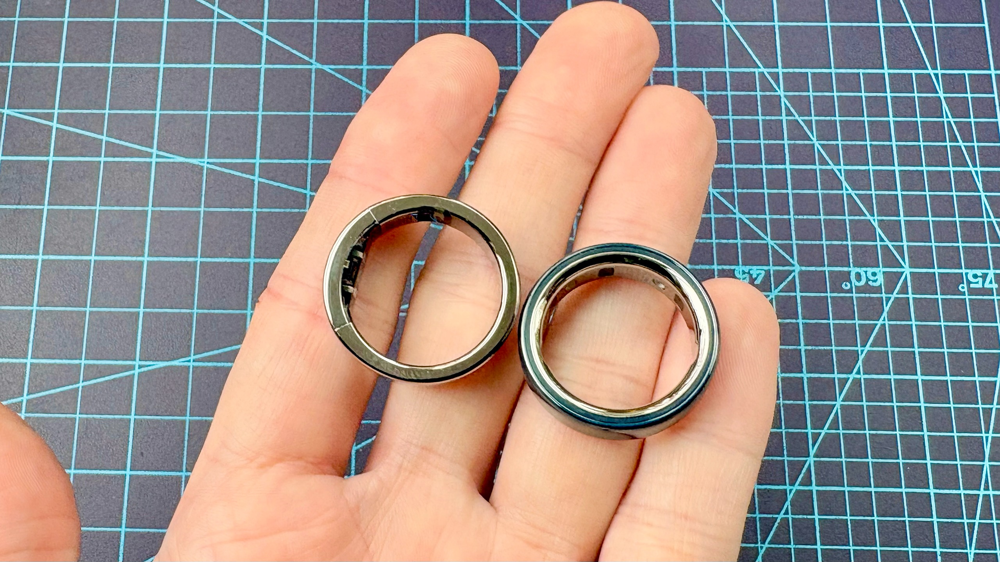
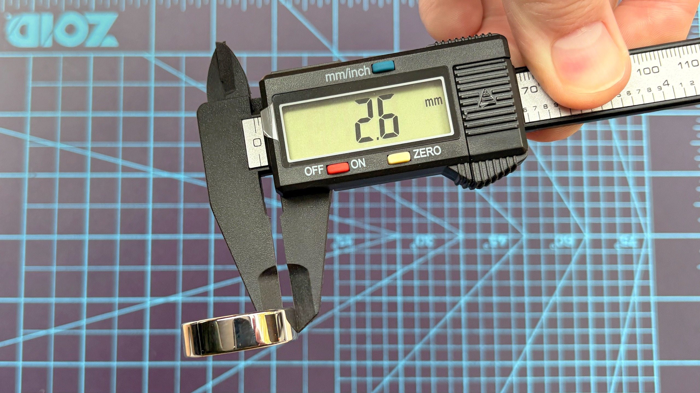
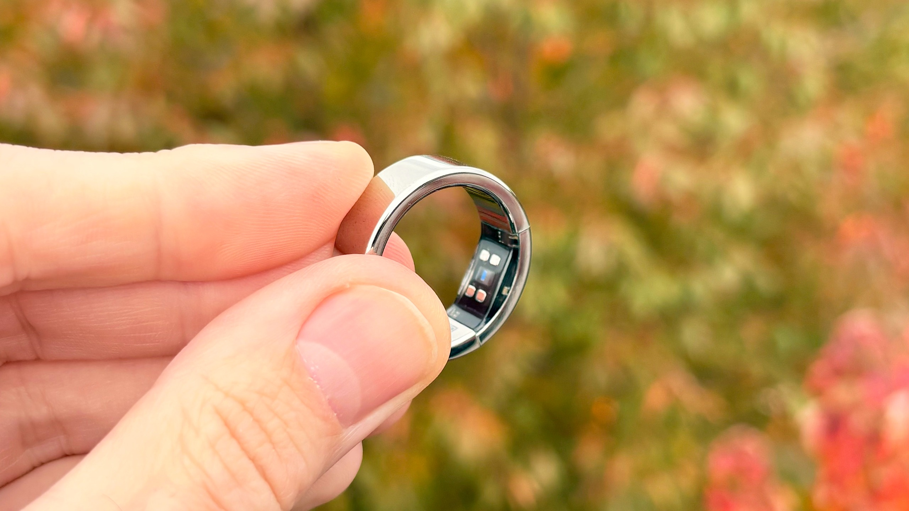

El **Ultrahuman Ring Pro** propone registrar el sueño y la recuperación sin añadir una cuota por sus funciones principales. El anillo ya está en tiendas de Estados Unidos por **479 dólares**, con estuche de carga incluido, según las primeras impresiones publicadas por Tom’s Guide este 30 de octubre. La novedad es esa llegada al comercio estadounidense: no un estreno mundial del dispositivo ni una confirmación de precio para España.

Dan Bracaglia, autor de la toma de contacto, lleva unos días utilizándolo y todavía prepara su análisis completo. Sus observaciones permiten valorar el diseño y el planteamiento comercial, pero no demostrar la precisión de los sensores o la autonomía real. TechSpain24 no ha probado el anillo.

## Ultrahuman Ring Pro: qué incluye el precio sin suscripción

Los 479 dólares cubren el anillo y el estuche Pro. Tom’s Guide recoge cuatro acabados —dorado, plateado, negro y titanio— y tallas del 5 al 14. La ausencia de cuota se refiere a las funciones principales; no debe interpretarse como una garantía de acceso gratuito a cualquier servicio adicional del ecosistema.

La comparación económica exige mirar más allá del desembolso inicial. El medio sitúa al Ring Pro 79 dólares por encima del precio de entrada del Oura Ring 5, pero recuerda que este último añade una suscripción. Para quien pretende llevar el mismo anillo durante años, el coste acumulado importa tanto como el precio de la caja. Es una referencia estadounidense, no una equivalencia directa en euros.

## Más volumen en el dedo y un diseño renovado

El Ring Pro utiliza una estructura de titanio de una sola pieza, descrita también en la [página oficial de Ultrahuman](https://www.ultrahuman.com/us/ring-pro/). Incorpora ProRelease, una solución concebida para facilitar que personal sanitario corte el anillo si una lesión o hinchazón del dedo obliga a retirarlo. No equivale a un mecanismo que lo abra automáticamente.

El tamaño es la contrapartida más tangible. Bracaglia midió 4,52 gramos en su unidad plateada de talla 11 y señala un grosor de 2,6 mm en la banda, que alcanza aproximadamente 4,8 mm en los sensores. Son datos de esa unidad, no un peso idéntico para todas las tallas. Aunque afirma que tras un día apenas lo notaba, la comodidad sigue siendo una impresión personal de uso breve.

## Hasta 15 días anunciados, todavía sin prueba completa

Ultrahuman anuncia hasta **15 días por carga**. El periodista aún no ha comprobado si su unidad alcanza esa cifra. Para el usuario, la ventaja potencial sería pasar más noches registrando el sueño y menos tiempo pendiente del cargador, pero no hay aquí una medición independiente que permita dar por cumplida la promesa.

El fabricante también ha revisado el sensor de frecuencia cardiaca y el procesamiento. Tom’s Guide deja pendiente comprobar su precisión frente a otros dispositivos: disponer de hardware renovado no demuestra por sí solo que las lecturas de pulso, sueño o recuperación sean mejores. Tampoco convierte estos indicadores de bienestar en un diagnóstico médico.

## El estuche ayuda en los viajes; España queda por confirmar

El estuche puede recargar el anillo dos veces, según Tom’s Guide. De ahí sale la cifra de hasta 45 días lejos de un enchufe: suma la carga inicial y las recargas, no significa llevar el anillo 45 días seguidos sin quitárselo. Incluye indicadores luminosos y avisos sonoros y hápticos; la web oficial también anuncia hasta 45 días con el cargador.

El producto amplía una plataforma que ya abordamos con la [integración del historial médico en la app de Ultrahuman](/noticias/wearables/ultrahuman-historial-medico-anillo-inteligente/), una novedad distinta de este hardware. Para una compra desde España, las fuentes consultadas no confirman tarifa local ni condiciones de distribución. Si la prioridad es evitar cuotas, el Ring Pro merece seguimiento; si se busca autonomía y precisión demostradas antes de pagar, conviene esperar al análisis completo.

*Fotografías: Dan Bracaglia / Tom’s Guide.*
